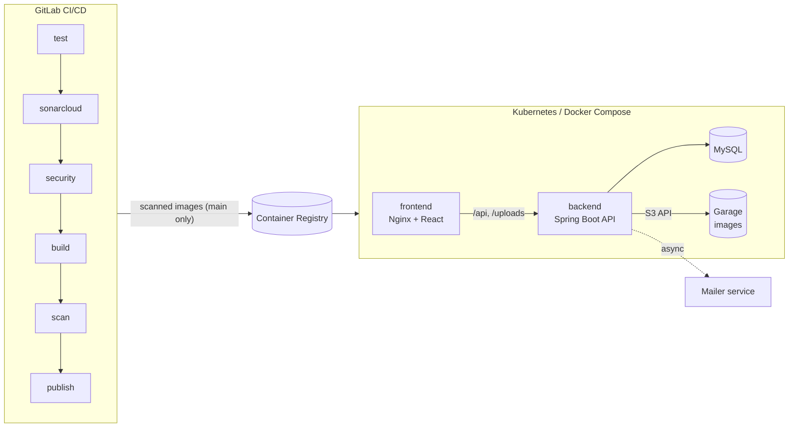

# Ktebna

[](https://github.com/Saifexe/Ktebna)


**A peer-to-peer book marketplace for Tunisia, delivered through a security-gated DevSecOps pipeline.**

Readers list the books they've finished, then sell, swap or give them away, and chat with each other to arrange the handover. Around the app sits the main focus of the project: an automated CI/CD pipeline with tests and security scans, containerized deployment on Docker Compose and Kubernetes, and monitoring with alerts.

Built during the Arabsoft summer internship 2026.

---

## Contents

- [Features](#features)
- [Tech stack](#tech-stack)
- [Architecture](#architecture)
- [Project structure](#project-structure)
- [Getting started](#getting-started)
- [Configuration](#configuration)
- [Testing](#testing)
- [CI/CD pipeline](#cicd-pipeline)
- [Monitoring](#monitoring)
- [Kubernetes](#kubernetes)
- [Limitations](#limitations)
- [License](#license)

---

## Features

- **Browse & search:** search by title or author and filter by deal type, category (25 of them) and city. Filters live in the URL, so a search can be shared as a link.
- **Listings:** a three-step "List a Book" flow with a live preview: photo and details, then condition and deal type (sale in TND, swap or free gift), then pickup city with an optional map pin. Owners can edit, hide, delete or mark a book Reserved or Sold.
- **Saved books:** heart up to six books to keep a shortlist.
- **Messaging:** one conversation per pair of readers, with unread badges, a popup for new messages and an email notification sent in the background.
- **Accounts & profiles:** email/password sign-up with JWT, profile photo, and a public reader profile showing what someone offers. Emails and private data never appear on it.
- **Free library:** readers share links to books that are free to read (public domain or publisher excerpts).
- **Three languages:** English, French and Arabic, with a full right-to-left layout in Arabic. Light and dark themes.

---

## Tech stack

- **Frontend:** React 19, Vite, Tailwind CSS, TanStack Query, React Router, react-i18next, Google Maps (optional)
- **Backend:** Spring Boot 3.5 (Java 17), Spring Security with JWT, Spring Data JPA
- **Database:** MySQL 8.0, with the schema versioned by Flyway migrations
- **Image storage:** Garage, a lightweight S3-compatible object store, so every backend instance sees the same uploads
- **Containers:** Docker Compose for the full local stack, Kubernetes manifests for cluster deployment
- **Monitoring:** Spring Boot Actuator + Micrometer, Prometheus, Alertmanager, Grafana
- **CI/CD & security:** GitLab CI/CD, SonarCloud (code analysis), Gitleaks (secret detection), Trivy (dependency and image vulnerabilities)

---

## Architecture



Nginx serves the React app and forwards `/api` and `/uploads` requests to the backend, so the browser only ever talks to one address. The backend stores data in MySQL and uploaded images in a private Garage bucket. The same images run unchanged on Docker Compose and Kubernetes.

---

## Project structure

```
.
├── backend/              Spring Boot API (controllers, services, entities, Flyway migrations, tests)
├── ktebna/               React frontend (pages, components, translations, tests)
├── k8s/                  Kubernetes manifests and backup jobs
├── monitoring/           Prometheus, Alertmanager and Grafana configuration
├── scripts/              Helper scripts for local development and Kubernetes
├── docs/                 Pipeline security-gate policy
├── docker-compose.yml    Full local stack
└── .gitlab-ci.yml        CI/CD pipeline
```

---

## Getting started

### Option A: Docker Compose (full stack)

You need Docker Desktop.

```bash
git clone https://github.com/Saifexe/Ktebna.git
cd Ktebna
cp .env.example .env      # fill in the required values (see Configuration)
docker compose up -d --build
```

Then open http://localhost:5173. Grafana is at http://localhost:3000 and Prometheus at http://localhost:9090. Every port listens on `127.0.0.1` only, so the stack can't be reached from other machines.

### Option B: Local development (hot reload)

You need Java 17, Node.js 20.19+ and a MySQL 8 server with an empty `ktebna` database.

1. Copy `.env.example` to `.env` and fill in at least `DB_PASSWORD` and `JWT_SECRET`.
2. Start the backend on http://localhost:8080 with `scripts/dev-backend.ps1` (Windows) or `scripts/dev-backend.sh` (macOS/Linux). The script loads `.env` for you, and Flyway creates the tables on first start.
3. Start the frontend:
   ```bash
   cd ktebna
   cp .env.example .env    # set VITE_API_URL=http://localhost:8080
   npm install
   npm run dev
   ```

---

## Configuration

All settings come from `.env` files, which are never committed. Start from the templates [`.env.example`](./.env.example) and [`ktebna/.env.example`](./ktebna/.env.example); each variable is explained there.

Secrets have no default values on purpose: the app refuses to start if a required one is missing or too weak, rather than running with a guessable password. You can generate one with `openssl rand -base64 32`.

Google Maps is optional. Without `VITE_GOOGLE_MAPS_API_KEY` the map picker is hidden and everything else keeps working.

---

## Testing

- **Backend:** 121 unit and integration tests, 95% line coverage. Integration tests run the real API against a real MySQL database started by Testcontainers.
  ```bash
  cd backend && ./mvnw test      # needs Docker running
  ```
- **Frontend:** 176 tests with Vitest and React Testing Library, 81% line coverage. They cover the main pages end to end against a mocked API.
  ```bash
  cd ktebna && npm test
  ```

---

## CI/CD pipeline

The pipeline in [`.gitlab-ci.yml`](./.gitlab-ci.yml) runs on every push, and each stage must pass before the next one starts:

1. **test:** backend and frontend tests, plus linting
2. **sonarcloud:** static code analysis with a blocking quality gate
3. **security:** secret scan of the full git history (Gitleaks) and dependency vulnerability scans (Trivy)
4. **build:** Docker images for the backend and frontend
5. **scan:** vulnerability scan of the built images
6. **publish:** push the images to the registry, on `main` only

An image reaches the registry only if it passed its own scan, and what gets published is exactly what was scanned. A nightly scheduled run re-scans the published images, because new vulnerabilities are disclosed every day. The gate rules are described in [docs/SECURITY_GATES.md](./docs/SECURITY_GATES.md).

---

## Monitoring

The backend exposes metrics that Prometheus collects. A Grafana dashboard, set up automatically, shows request rate, errors, latency, JVM health and the database connection pool. Alert rules cover cases such as the backend being down, high error rate or latency, and low memory or disk. Alertmanager can email them if you configure it in `.env`.

Monitoring currently runs in Docker Compose only.

---

## Kubernetes

The `k8s/` folder deploys MySQL, Garage, the backend and the frontend into a `ktebna` namespace. It also includes nightly backup jobs for the database and the uploaded images. The cluster runs the exact images published by the pipeline. Secrets are created by hand and never committed. See [k8s/README.md](./k8s/README.md) for the steps.

```bash
kubectl apply -f k8s/
kubectl port-forward svc/frontend -n ktebna 8081:80    # then open http://localhost:8081
```

---

## Limitations

- **Near-real-time chat:** messages and unread counts update by polling every few seconds, not over WebSockets.
- **Slow first email:** the mailer runs on a free host that sleeps when idle, so the first email after a quiet period can take up to a minute. Chat itself is not affected.
- **Maps need a key:** without a Google Maps API key, the map features are hidden.

---

## License

Internship project. All rights reserved: the code is public to read, but no license is granted to reuse or redistribute it.
