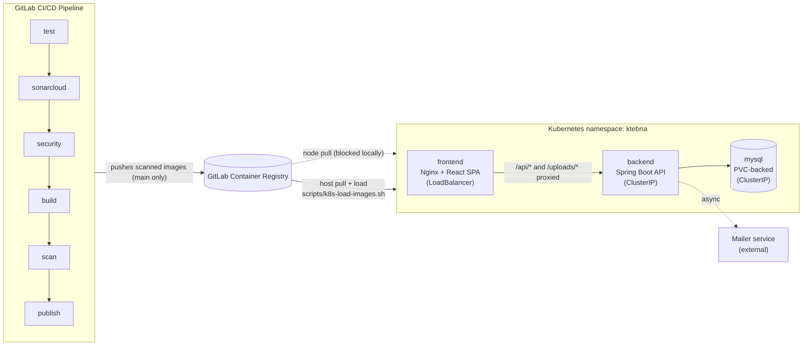
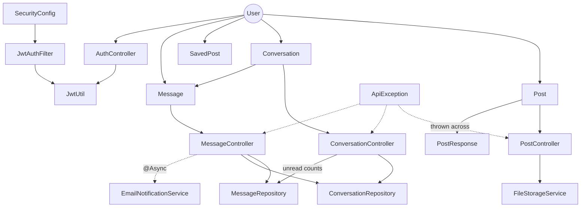

# Ktebna

**A peer-to-peer book marketplace for Tunisia, and the subject of a DevSecOps CI/CD pipeline project.**

Readers list the books they've finished, then sell, swap, or give them away, and chat with each other to arrange the handover. Around that app sits the actual focus of the project: a security-gated GitLab CI/CD pipeline, Kubernetes manifests, monitoring, and the operational practices (incident response, credential management, rollback procedures) that go with them.

Built as part of the Arabsoft summer internship 2026.

For the full security posture, incident history, and credential-rotation record, see **[SECURITY.md](./SECURITY.md)**. For the per-job pipeline policy, see **[docs/SECURITY_GATES.md](./docs/SECURITY_GATES.md)**.

---

## Contents

- [What's new in v2](#whats-new-in-v2)
- [Features](#features)
- [Tech stack](#tech-stack)
- [Architecture](#architecture)
- [Project structure](#project-structure)
- [Getting started](#getting-started)
- [Configuration](#configuration)
- [API reference](#api-reference)
- [Testing](#testing)
- [CI/CD pipeline](#cicd-pipeline)
- [Monitoring](#monitoring)
- [Kubernetes deployment](#kubernetes-deployment)
- [Rollback runbook](#rollback-runbook)
- [Known issues](#known-issues)

---

## What's new in v2

Version 2 rebuilds the frontend on a new visual design and adds the features that design called for, while staying on the same Spring Boot API and MySQL database.

- **New design system:** warm terracotta palette, Merriweather + Plus Jakarta Sans type, light and dark themes, mobile tab bar.
- **New pages:** book detail page, three-step "List a Book" flow, two-pane inbox, and a profile page with listing management. These replace the old account sidebar and modal forms.
- **Richer listings:** author, condition (Like New → Collector's Rare), free-text description, 10 new categories (25 in total), and an optional meeting spot picked on a Google Map.
- **Messaging:** a red unread badge (1–8, then `9+`), per-conversation unread counts, and an animated popup when a message arrives. Sending no longer waits for the email notification.
- **Server-side search** by title or author, combined with category, deal-type, and city filters stored in the URL.
- **Fixes to existing behaviour:** post visibility (public/hidden) now actually toggles; deleting a bookmarked post or an account with listings no longer fails.

Old `/account/*` URLs redirect to their new equivalents.

---

## Features

**Browse & search**
- Catalog with hero search (title or author), filter chips for deal type and category, and a city selector. All filters live in the query string, so results are shareable.
- 25 categories, from Fiction and Arabic Literature to Manga & Comics and Education & Textbooks.

**Listings**
- Three-step "List a Book" flow: photo and details, then condition and deal type (Direct Sale / Book Swap / Free Giving), then pickup city, optional map pin, and visibility. It shows a live preview card.
- Sale prices are always in Tunisian dinars: the seller types only the amount next to a fixed **TND** label, and the backend stores it as `<amount> TND` (up to 3 decimals, for millimes) and refuses other currencies or words. Swap wishes stay free text.
- Book page with condition badge, deal box, seller card, description, pickup details, map, and an "Open in Google Maps" link.
- Owners can edit, hide/show, and delete their listings from their profile.
- Each listing has a status the owner sets from their profile: **Available**, **Reserved** (a deal is being arranged; buyers can still ask to be next in line) or **Sold**, worded "Swapped" or "Given away" for swaps and gifts. Sold books leave the catalog but stay reachable by link, in the owner's profile and in readers' saved books, and their page no longer offers to message the seller.

**Saved books**
- Heart any book to add it to your shortlist (up to 6 at a time).

**Messaging**
- One conversation per pair of users, opened from any book page ("Message Seller").
- Unread badge in the header and mobile tab bar, unread counts per conversation, and a popup for new messages. Opening a chat marks it read; replying marks earlier messages read.
- Email notification to the recipient, sent in the background.

**Account**
- Email/password sign-up and login (JWT), profile photo, name editing, account deletion.
- Public reader profiles (`/user/:id`), open to visitors: photo, name, "member since", the books they currently offer, and how many deals they've completed, with a button to message them. Reached from the seller card on a book page and from a chat's header. Emails, hidden listings, saved books and conversations never appear there.

**Everywhere**
- Fast repeat visits: Nginx lets browsers keep versioned JS/CSS for a year and uploaded covers for a week (their names never change), always re-checks the page itself so a new release shows at once, compresses text and API responses (about 4× smaller JSON), and keeps connections to the backend open between requests.
- English, French, and Arabic, with full right-to-left layout in Arabic.
- Free PDF library (`/books`): readers share links to books that are free to read (public domain or publisher excerpts), with language and category filters.

---

## Tech stack

| Layer | Technology |
|---|---|
| Frontend | React 19, Vite 7, Tailwind CSS 4, TanStack Query, React Router 7, framer-motion, react-i18next (EN/FR/AR), MUI (dialogs), `@vis.gl/react-google-maps` |
| Backend | Spring Boot 3.5, Java 17, Maven, Spring Security + JWT, Spring Data JPA |
| Database | MySQL 8.0 (schema managed by Hibernate `ddl-auto=update`) |
| File storage | Local disk (`uploads/`), PVC-backed in Kubernetes |
| Maps | Google Maps JavaScript API + Places API (New). Optional. |
| Email | External mailer microservice (`MAILER_URL`), called asynchronously |
| Local orchestration | Docker Compose |
| Container orchestration | Kubernetes (local cluster via Docker Desktop) |
| Monitoring | Spring Boot Actuator + Micrometer, Prometheus, Alertmanager, Grafana |
| CI/CD | GitLab CI/CD, shared GitLab runners |
| Security scanning | SonarCloud (SAST), Gitleaks (secrets), Trivy (filesystem + image vulnerabilities) |

**History note:** the application was originally built on React + Supabase, then migrated to React + Spring Boot + MySQL so that this DevSecOps exercise would target self-controlled infrastructure rather than a managed backend-as-a-service.

---

## Architecture

### Deployment topology



Nginx serves the frontend as static assets and reverse-proxies `/api/*` and `/uploads/*` requests to the backend Service. Docker Compose and Kubernetes both have a service named `backend` on port `8080`, so the same image works in both environments without knowing a hostname at build time.

### Backend domain model



- A **Post** stores the book (name, author, category, condition, description, deal type and terms), its pickup city, and an optional map pin (`pickupLat`, `pickupLng`, `pickupSpot`).
- A **Conversation** links two users and records, for each participant, the id of the newest message they have read. The unread count is every message from the other participant that is newer than that id and newer than your own latest reply.

---

## Project structure

```
.
├── backend/                  Spring Boot API (Maven Wrapper: ./mvnw)
│   ├── Dockerfile
│   └── src/main/java/com/ktebna/backend/
│       ├── config/           Security (JWT filter chain, CORS), static uploads
│       ├── controller/       Auth, Post, SavedPost, Conversation, Message, User, Library
│       ├── dto/              Request/response records
│       ├── entity/           User, Post, SavedPost, Conversation, Message, LibraryBook
│       ├── repository/       Spring Data JPA repositories
│       ├── security/         JwtUtil, JwtAuthFilter
│       └── service/          FileStorageService, EmailNotificationService
│   └── src/test/java/…/      unit/ (no Spring) and api/ (Testcontainers MySQL) tests
├── ktebna/                   React frontend (Vite)
│   ├── Dockerfile, nginx.conf
│   └── src/
│       ├── pages/            Catalog, BookDetail, Sell, Saved, Messages, Profile, About, Contact, Library, LibraryBook, ShareBook
│       ├── components/       Header, BottomNav, BookCard, MessagePopups, maps/ …
│       ├── ui/               Button, Badge, Avatar, UnreadBadge, Spinner, EmptyState
│       ├── context/          Auth prompt, notifications (unread polling)
│       ├── hooks/            useSaved, useUnread, useRequireAuth
│       ├── lib/              Listing vocabulary, map helpers
│       ├── locales/          EN/FR/AR strings for the redesigned screens
│       ├── i18n.js           i18next setup (+ RTL for Arabic)
│       └── index.css         Design tokens (light + dark)
├── k8s/                      Kubernetes manifests
├── monitoring/               Prometheus scrape config + alert rules, Alertmanager config, Grafana provisioning
├── scripts/                  dev-backend.ps1 / .sh: start the API with .env loaded
├── docs/SECURITY_GATES.md    Pipeline gate policy
├── docker-compose.yml        Full local stack (6 services)
├── .gitlab-ci.yml            CI/CD pipeline
└── SECURITY.md               Security posture and incident history
```

---

## Getting started

### Option A: Docker Compose (full stack)

**Prerequisites:** Docker Desktop.

```bash
git clone https://gitlab.com/saifexd-group/ktebna.git
cd ktebna
cp .env.example .env    # then fill in the required values (see Configuration)
docker compose up -d --build
```

All ports are bound to `127.0.0.1`, so the stack is reachable only from your own machine. Compose refuses to start if a required secret is missing from `.env`.

| Service | URL | Notes |
|---|---|---|
| `frontend` | http://localhost:5173 | Nginx serving the built SPA, proxies `/api` |
| `backend` | http://localhost:8080 | Spring Boot API |
| `mysql` | `localhost:3307` | MySQL 8.0 (container port 3306) |
| `prometheus` | http://localhost:9090 | Scrapes `/actuator/prometheus`; evaluates rules in `monitoring/prometheus/alerts.yml` |
| `alertmanager` | http://localhost:9093 | Receives firing alerts from Prometheus. No notification integration configured (visible in its UI and in Grafana only) |
| `grafana` | http://localhost:3000 | User `admin`, password from `GRAFANA_ADMIN_PASSWORD` (applied when Grafana's volume is first created) |

### Option B: Local development (hot reload)

**Prerequisites:** Java 17, Node.js 20.19+ (or 22.12+), and a MySQL 8 / MariaDB server (for example XAMPP on port 3306) with a `ktebna` database and a user that can create tables. Maven is not required: the repo ships the Maven Wrapper (`backend/mvnw`), which downloads a checksum-pinned Maven 3.9.11 on first use.

1. **Secrets:** `cp .env.example .env` and fill in at least `DB_PASSWORD` and `JWT_SECRET`.

2. **Backend:** the script loads `.env`, checks the required values, and starts the API on http://localhost:8080:
   ```powershell
   powershell -ExecutionPolicy Bypass -File scripts\dev-backend.ps1   # Windows
   ```
   ```bash
   ./scripts/dev-backend.sh                                          # macOS / Linux / Git Bash
   ```
   Hibernate creates or updates the tables on startup. For IntelliJ, run `KtebnaBackendApplication` with the same variables from `.env` in the run configuration's *Environment variables*.

3. **Frontend**, from `ktebna/`:
   ```bash
   cp .env.example .env      # set VITE_API_URL=http://localhost:8080
   npm install
   npm run dev
   ```
   Open http://localhost:5173.

---

## Configuration

Secrets live in `.env` files that are **never committed** (see `.gitignore`). Start from the templates: [`.env.example`](./.env.example) (repo root) and [`ktebna/.env.example`](./ktebna/.env.example). **No secret has a default:** Compose and the backend refuse to start without them. Generate values with `openssl rand -base64 32`.

### Backend (repo-root `.env`, read by Docker Compose, or exported before `mvn spring-boot:run`)

| Variable | Default | Purpose |
|---|---|---|
| `DB_HOST` / `DB_PORT` / `DB_NAME` | `localhost` / `3306` / `ktebna` | MySQL location |
| `DB_USER` / `DB_PASSWORD` | `ktebna_user` / **required** | MySQL credentials |
| `DB_ROOT_PASSWORD` | **required** (Compose) | MySQL root password |
| `JWT_SECRET` | **required** | JWT signing key, at least 32 random characters. The backend refuses to start with anything weaker. |
| `CORS_ALLOWED_ORIGINS` | `http://localhost:5173,http://127.0.0.1:5173` | Browser origins allowed to call the API directly (the Nginx proxy doesn't need it) |
| `JWT_EXPIRATION_MS` | `604800000` (7 days) | Token lifetime |
| `UPLOAD_DIR` | `./uploads` | Where uploaded images are stored |
| `MAILER_URL` | external Render service | Email notification endpoint |
| `DDL_AUTO` | `update` | Hibernate schema mode |
| `GRAFANA_ADMIN_PASSWORD` | **required** (Compose) | Grafana admin login |

### Frontend (`ktebna/.env`, inlined at **build** time by Vite)

| Variable | Purpose |
|---|---|
| `VITE_API_URL` | Backend base URL. Leave empty behind Nginx (relative `/api`); set `http://localhost:8080` for `npm run dev`. |
| `VITE_GOOGLE_MAPS_API_KEY` | Enables the map picker and book-page maps. Leave empty to hide them. |
| `VITE_GOOGLE_MAPS_MAP_ID` | Optional Map ID; defaults to Google's `DEMO_MAP_ID`. |

### Enabling Google Maps

1. In Google Cloud Console, create an API key.
2. Enable the **Maps JavaScript API** and **Places API (New)** for it.
3. Restrict the key by HTTP referrer (for example `http://localhost:5173/*` plus your production domain).
4. Put the key in `ktebna/.env` for local development (`npm run dev`), and in a masked GitLab CI/CD variable `VITE_GOOGLE_MAPS_API_KEY` for pipeline builds.
5. For Docker Compose builds, set `VITE_GOOGLE_MAPS_API_KEY` in the root `.env`. It reaches the build as a BuildKit **secret** (never a build argument), so it doesn't end up in the image history. BuildKit doesn't include secret values in its cache key, so after adding or changing the key rebuild with `docker compose build --no-cache frontend`.

Without a key, everything else keeps working; the "Open in Google Maps" link on book pages does not need a key.

---

## API reference

All endpoints are under `/api`. **Auth** means a valid `Authorization: Bearer <jwt>` header is required.

| Method | Path | Auth | Description |
|---|---|---|---|
| `POST` | `/auth/register` | – | Create account; returns `{ token, user }` |
| `POST` | `/auth/login` | – | Log in; returns `{ token, user }` |
| `GET` | `/auth/me` | ✓ | Current user |
| `GET` | `/posts` | – | Public feed. Query: `search`, `category`, `dealType`, `location`, `page`, `size` |
| `GET` | `/posts/{id}` | – | One listing |
| `GET` | `/posts/me` | ✓ | Your listings (public and hidden) |
| `POST` | `/posts` | ✓ | Create listing (multipart, see fields below) |
| `PUT` | `/posts/{id}` | ✓ owner | Update listing (multipart) |
| `PATCH` | `/posts/{id}/visibility` | ✓ owner | Body `{ "isPublic": true \| false }` |
| `PATCH` | `/posts/{id}/status` | ✓ owner | Body `{ "status": "AVAILABLE" \| "RESERVED" \| "SOLD" }`; `SOLD` removes the listing from the feed |
| `DELETE` | `/posts/{id}` | ✓ owner | Delete listing (also removes others' bookmarks of it) |
| `GET` | `/saved-posts` | ✓ | Your saved listings |
| `GET` | `/saved-posts/ids` | ✓ | Ids of your saved listings |
| `POST` / `DELETE` | `/saved-posts/{postId}` | ✓ | Save / unsave (max 6) |
| `GET` | `/conversations` | ✓ | Your conversations, newest first |
| `GET` | `/conversations/with/{userId}` | ✓ | Your conversation with a user, if any |
| `GET` | `/conversations/unread` | ✓ | `{ total, conversations: [{ conversationId, count, otherUser, … }] }` |
| `POST` | `/conversations/{id}/read` | ✓ participant | Mark a conversation read |
| `GET` | `/conversations/{id}/messages` | ✓ participant | Messages, oldest first |
| `POST` | `/messages` | ✓ | Body `{ otherUserId, bookName?, messageContent }`; creates the conversation if needed |
| `PUT` | `/account/name` | ✓ | Rename |
| `GET` | `/users/{id}/profile` | – | Public profile: name, photo, member since, books on offer, completed deals (never the email) |
| `GET` | `/users/{id}/posts` | – | That reader's public, unsold listings, paginated |
| `POST` | `/account/profile-picture` | ✓ | Upload avatar (multipart `file`) |
| `GET` | `/library` | – | Free library. Query: `search`, `language` (`en` · `fr` · `ar`), `category`, `page`, `size` |
| `GET` | `/library/{id}` | – | One library book |
| `POST` | `/library` | ✓ | Share a book (multipart: `title`, `language`, `pdfUrl` required; `author`, `category`, `description`, `image`) |
| `DELETE` | `/library/{id}` | ✓ sharer | Remove a book you shared |
| `DELETE` | `/account` | ✓ | Delete account and everything that belongs to it |

Hidden listings return `404` to everyone except their owner. Email addresses are only returned to their owner. Abuse-prone endpoints are rate-limited and answer `429` with `Retry-After`. Text fields are length-limited to their database columns (a longer value is a `400`), and page sizes are capped at 50.

**Listing fields** (multipart): `bookName` (required), `bookAuthor`, `bookCategory`, `bookCondition` (`likeNew` · `gentlyRead` · `wellLoved` · `collectors`), `bookDealType` (`sell` · `exchange` · `donate`), `bookDeal` (price or swap wish), `bookDescription`, `bookLocation` (city), `pickupLat`, `pickupLng`, `pickupSpot`, `isPublic`, `image`.

Images must be real JPEG, PNG, GIF or WebP files (checked by content, not by file name), up to **8 MB** (enforced by both Nginx and Spring). Uploaded images are served from `/uploads/**`; health and metrics from `/actuator/health` and `/actuator/prometheus`.

---

## Testing

The backend has **89 automated tests** with **94.9% line coverage**:

| Layer | What it covers | How |
|---|---|---|
| Unit (`src/test/java/.../unit`) | JWT signing and validation (including refusing weak secrets), image-content checks, the rate limiter (limits, per-user buckets, spoofed `X-Real-IP`), the email notifier | Plain JUnit 5, no Spring or database; runs in milliseconds |
| Integration (`src/test/java/.../api`) | The HTTP API end to end: sign-up and login, listings (search, filters, hidden posts, ownership), saved books (6-book cap), messaging and unread counts, the free library, input limits, account deletion, privacy (no leaked emails), error responses, 401 vs 403 | Full Spring Boot app with MockMvc against a **real MySQL 8** started by [Testcontainers](https://testcontainers.com); the mailer is mocked |

Every bug fixed in v2 has a regression test (visibility toggle, deleting bookmarked posts or accounts with data, leaked emails, expired tokens answering 403 instead of 401, …).

```bash
cd backend
./mvnw test          # needs Docker running (for the MySQL container)
```

Coverage is written to `backend/target/site/jacoco/index.html`. In CI, GitLab shows the test results in the pipeline's **Tests** tab and the coverage percentage on the job; SonarCloud reads the same JaCoCo report.

The frontend has **170 tests** (Vitest + React Testing Library, in a simulated browser) covering 81% of its lines:

- **Logic:** deal labels, listing statuses, dates, map links, the API client's token handling, session restore and login/logout, the chat service, and a check that French and Arabic translate every English string, category and city.
- **Components:** the header (search, language menu, unread badge), book cards, covers, pagination, the saved-books shelf, the login form, the login prompt and the route guard.
- **Pages, end to end against a mocked API:** browsing with search, filters and pagination; the book page (owner vs. visitor, private listings, messaging); the three-step "List a Book" flow with its validation; the inbox; the profile (status, hide, delete, rename); public reader profiles; and the Free Library (browse and filter, open or remove a PDF, and the share form, which only accepts http(s) links).

```bash
cd ktebna
npm test                 # run once
npm run test:coverage    # plus a coverage report in ktebna/coverage/
```

---

## CI/CD pipeline

Defined in [`.gitlab-ci.yml`](./.gitlab-ci.yml). Six stages run on every push; the `publish` stage runs on `main` only:

| Stage | Job | What it does | Blocking? |
|---|---|---|---|
| `test` | `backend-test` | 89 unit + integration tests against MySQL 8 (Testcontainers on Docker-in-Docker); publishes JUnit results and JaCoCo coverage | **Yes** |
| `test` | `frontend-test` | `npm run lint` (ESLint), then 170 Vitest tests; publishes JUnit results and lcov coverage | **Yes** |
| `sonarcloud` | `sonarcloud-check` | SonarCloud SAST (on `main` only); waits for the quality gate verdict | **Yes**, when the quality gate fails |
| `security` | `gitleaks` | Secret scan of the working tree **and full git history** | **Yes** |
| `security` | `trivy-fs-backend` | Maven dependency vulnerabilities | **Yes**, on fixable HIGH/CRITICAL |
| `security` | `trivy-fs-frontend` | npm dependency vulnerabilities (`package-lock.json`) | **Yes**, on fixable HIGH/CRITICAL |
| `build` | `build-backend` | Docker build, saved as a job artifact (**not pushed**) | **Yes** |
| `build` | `build-frontend` | Docker build (runs `npm run build`), saved as a job artifact (**not pushed**) | **Yes** |
| `scan` | `trivy-backend-image` | Scans the saved image | **Yes**, on fixable HIGH/CRITICAL |
| `scan` | `trivy-frontend-image` | Scans the saved image | **Yes**, on fixable HIGH/CRITICAL |
| `publish` | `publish-backend` | Pushes the scanned image (`:<short-sha>` and `:latest`), `main` only | **Yes** |
| `publish` | `publish-frontend` | Pushes the scanned image (`:<short-sha>` and `:latest`), `main` only | **Yes** |

Images reach the registry only after their own scan passes, and what gets pushed is the exact artifact that was scanned. Only `main` publishes, because it is the only branch the blocking SonarCloud gate runs on: a push to any other branch can't replace `:latest` with code the gate never reviewed. Each Trivy job first prints a full report (all severities, never fails), then runs the gate: HIGH/CRITICAL findings that have a fixed version fail the job. CVEs with no fix yet stay visible in the report but don't block, since there is nothing to upgrade to.

**Saving runner minutes.** The free plan allows 400 CI minutes a month, so the pipeline avoids waste: a push that only changes documentation (`*.md` outside the code folders) starts no pipeline at all; a pipeline for an older commit is cancelled when a newer push arrives (except the publish jobs, which are never cut off mid-push); and each cache is scoped to the jobs that use it: Maven for `backend-test`, npm for `frontend-test`, and one shared Trivy vulnerability database for the Trivy jobs.

**Nightly scan.** New CVEs are published every day, so an image that was clean when it was pushed can become vulnerable without any code change. A pipeline schedule (CI/CD → Schedules, every night on `main`) runs only `nightly-scan-backend` and `nightly-scan-frontend`: they re-scan the `:latest` images already in the registry with the same HIGH/CRITICAL gate, and every other job is skipped. A red nightly pipeline usually just means the image needs rebuilding, since the frontend's `apk upgrade` and a fresh base image pick up the fixed packages.

**CI/CD variables** (Settings → CI/CD → Variables):

| Variable | Required | Used by |
|---|---|---|
| `SONAR_TOKEN` | yes | `sonarcloud-check` |
| `VITE_API_URL` | no | `build-frontend` (defaults to empty: same-origin `/api` through the image's Nginx) |
| `VITE_GOOGLE_MAPS_API_KEY` | no | `build-frontend`; mark it **masked** |
| `VITE_GOOGLE_MAPS_MAP_ID` | no | `build-frontend` |

`CI_REGISTRY_*` credentials are provided by GitLab automatically.

**Run the blocking checks locally before pushing:**

```bash
(cd backend && ./mvnw -B test && ./mvnw -B -DskipTests package)   # Docker must be running
(cd ktebna && npm ci && npm run lint && npm run build)
```

---

## Monitoring

The backend exposes Micrometer metrics at `/actuator/prometheus`, including histogram buckets for `http.server.requests` (`management.metrics.distribution.percentiles-histogram`), which is what lets Grafana/Prometheus compute real percentile latencies rather than just averages.

In Docker Compose, Prometheus scrapes those metrics and Grafana auto-provisions its datasource and dashboard from `monitoring/grafana/provisioning`. The dashboard (`ktebna-overview.json`) is organized into five rows:
- **Golden Signals** — request rate by outcome, error rate %, p99 latency, latency by endpoint, traffic by endpoint
- **JVM & Process** — heap used/max, threads, GC pause time, CPU usage
- **Database (HikariCP)** — connection pool usage, acquire time, timeouts
- **Infra, Sessions & Logs** — uptime, disk free, active sessions, log events by level
- **Alerts** — count of currently firing alerts and a table of which ones

### Alerting

Prometheus evaluates the rules in `monitoring/prometheus/alerts.yml` (backend down, high/critical error rate, high p99 latency, DB pool exhaustion, DB connection timeouts, JVM heap near max, low disk space) and forwards firing alerts to Alertmanager (`monitoring/alertmanager/alertmanager.yml`). Firing alerts are visible in Alertmanager's UI (http://localhost:9093), in Prometheus's Alerts page (http://localhost:9090/alerts), and in the Grafana dashboard's Alerts row.

**Email alerts (optional).** Set these in `.env`, then run `docker compose up -d alertmanager`:

```bash
ALERT_EMAIL_TO=you@example.com
ALERT_EMAIL_FROM=your.address@gmail.com
ALERT_SMTP_PASSWORD=<Gmail App Password>   # Google Account > Security > App passwords
# ALERT_SMTP_HOST=smtp.gmail.com:587      # default; change for another provider
```

Alertmanager then emails every firing alert, and again when it resolves. It can't read environment variables itself, so `monitoring/alertmanager/entrypoint.sh` fills them into the config at start-up and writes the password to a file only Alertmanager's user can read; it never appears in the config or in git. Without `ALERT_EMAIL_TO`, the email settings are left out and alerts stay in the UIs above. To try it, stop the backend (`docker compose stop backend`): `BackendDown` fires after about a minute and the email follows within a minute.

Monitoring is not deployed to Kubernetes (see [Known issues](#known-issues)).

---

## Kubernetes deployment

Manifests live in `k8s/`:
- `namespace.yaml`: the `ktebna` namespace
- `mysql.yaml`: MySQL Deployment, Service, and PVC
- `mysql.yaml` uses the `Recreate` strategy: two MySQL pods can't share one data volume, so the old pod stops before the new one starts
- `backend.yaml`: PVC (for uploads), Deployment, and Service. Readiness checks `/actuator/health` (app **and** database); liveness only checks that the process answers, so a database outage takes the pod out of rotation instead of restarting it
- `frontend.yaml`: frontend Deployment (non-root Nginx on port 8080, proxying `/api` and `/uploads` to the `backend` Service) and Service (`type: LoadBalancer`, port 80 → 8080)

Secrets are created by hand, never committed; see [k8s/README.md](./k8s/README.md).

### Deploy
The cluster runs the images CI published, never a local build: the same bytes the pipeline tested, scanned and pushed.
```bash
docker login registry.gitlab.com     # once; a personal access token with read_registry
scripts/k8s-load-images.sh <tag>     # 8-character short SHA of a green main pipeline; must match the manifests
kubectl apply -f k8s/
```

### Access locally
```bash
kubectl port-forward svc/frontend -n ktebna 8081:80
```
Then open **http://localhost:8081**. (The LoadBalancer's external IP is not directly reachable from the host in this local Docker Desktop setup, so port-forwarding is the supported access method.)

### Image references
The local node can't pull from the GitLab registry (see [Known issues](#known-issues)), so images are **loaded straight into the node** instead: `scripts/k8s-load-images.sh` pulls the CI-published `registry.gitlab.com/saifexd-group/ktebna/<app>:<tag>` on the host (whose registry pull works) and imports it into the node's container runtime. The manifests reference that exact tag with `imagePullPolicy: Never`, so a missing image fails loudly (`ErrImageNeverPull`) instead of falling back to the broken pull, and a `kubectl apply` never picks up unintended content. Use a commit SHA tag, never `:latest`. See the **[Rollback runbook](#rollback-runbook)** below for how to switch versions safely.

The manifests already name the registry images, so once the node's own pull works again the only changes are `imagePullPolicy: IfNotPresent` and a `gitlab-registry` pull secret through `imagePullSecrets`.

---

## Rollback runbook

### To roll back to the last known-good image
The most reliable method found during this project (more reliable than `kubectl rollout undo`, which can land on a broken intermediate revision if the deployment history contains failed attempts):

1. Identify a pod that is confirmed healthy and running the desired version:
   ```bash
   kubectl get pods -n ktebna
   ```
2. Read its exact image reference directly:
   ```bash
   kubectl get pod <healthy-pod-name> -n ktebna -o jsonpath="{.status.containerStatuses[0].imageID}"
   ```
3. Set the Deployment to that exact reference:
   ```bash
   kubectl set image deployment/<name> <container-name>=<image-reference> -n ktebna
   ```
4. Watch the rollout and confirm the new pod reaches `1/1 Running` before the old one terminates:
   ```bash
   kubectl rollout status deployment/<name> -n ktebna
   ```

### If a Deployment gets stuck with duplicate/failed ReplicaSets
Delete the Deployment entirely (not just the pods) and reapply from the manifest:
```bash
kubectl delete deployment <name> -n ktebna
kubectl apply -f k8s/<name>.yaml
```

### If pods enter `ImagePullBackOff`
Check the exact error with `kubectl describe pod <pod-name> -n ktebna` and read the `Events` section. Common causes on this project, in order of frequency encountered:
1. **`401 Unauthorized`:** the `gitlab-registry` Secret's credentials no longer match a valid deploy token. Verify directly (bypassing Docker) with:
   ```bash
   curl -u "<username>:<password>" "https://gitlab.com/jwt/auth?service=container_registry&scope=repository:saifexd-group/ktebna/<backend|frontend>:pull"
   ```
   A `200` with a `token` field proves the credential is valid; if the Secret still fails afterward, recreate it.
2. **`manifest unknown` / `not found`:** the tag doesn't exist. GitLab CI tags images with the 8-character short commit SHA (`$CI_COMMIT_SHORT_SHA`), so verify the exact tag in the GitLab Container Registry UI rather than assuming its length.
3. **`short read: unexpected EOF`:** a known, unresolved issue on this project's local Docker Desktop Kubernetes node; see SECURITY.md and the project history for the full diagnostic trail. It is not caused by credentials or a bad tag; both were independently ruled out.

With the current manifests (`imagePullPolicy: Never`), the equivalent error is **`ErrImageNeverPull`**: the tag in the manifest was never loaded into the node. Run `scripts/k8s-load-images.sh <tag>` with that tag. Images loaded earlier stay in the node, so rolling back is just `kubectl set image` to a previous tag.

---

## Known issues

- **Kubernetes image pull failure (unresolved, investigated and parked):** the local Docker Desktop Kubernetes node cannot pull newly built images past a fixed point (consistent `short read: unexpected EOF` at an identical byte offset). Ruled out across two sessions: credentials (verified valid via direct registry auth checks), tag vs. digest reference, a full Docker Desktop restart, proxy interference (registry added to Docker Desktop's proxy bypass list, then retried), and a full Kubernetes cluster reset. A control pull of a public Docker Hub image succeeded on the same node, so the issue is scoped to this private registry's pull path, not general networking. **Worked around on 22 Sep 2026:** images are now loaded straight into the node (`scripts/k8s-load-images.sh`, which since 24 Sep 2026 pulls the CI-published images on the host rather than using local builds), so the cluster runs the current app again, verified end to end (sign-up, listing with photo upload, image served back through Nginx, Library API). Until then it had been stuck on August images whose frontend called `localhost:8080` and had no `/api` proxy.
- **Monitoring** is implemented and verified in Docker Compose only (metrics scraping, dashboard auto-provisioning, live panel data). Not deployed to Kubernetes yet (the cluster runs only MySQL, backend and frontend).
- **Maps need a key:** without `VITE_GOOGLE_MAPS_API_KEY` the map picker and book-page maps are hidden.
- **Email notifications can be slow to arrive:** the mailer runs on a free host that sleeps when idle and can take up to a minute to wake. Chat messages are unaffected, because the email is sent in the background.
- **Near-real-time, not real-time:** unread counts refresh every 8 seconds and an open chat every 5 seconds (polling, not WebSockets).
- **One conversation per pair of users:** its book topic is set by the first message, so later chats between the same two people about another book stay under the original title.
- ~~**Accessibility:** a browser console warning (`aria-hidden` blocked on an element with focus)~~: re-tested 10 Aug 2026, no longer reproduces.

---

## A note on what this project demonstrates

The app-level bugs documented in this repo's history and in `SECURITY.md` (a race condition, a hardcoded config value, a misconfigured linter causing a false fix) are ordinary software bugs, not remarkable on their own. What this project is meant to show is the **process wrapped around them**: every one of those bugs was caught by a real gate or a real test rather than shipped silently, every credential incident was diagnosed with a repeatable, tool-independent verification method rather than guesswork, and every fix was verified in a lower environment before being pushed toward production. That process is the deliverable.

---

## License

Internal internship project, not licensed for external distribution.
