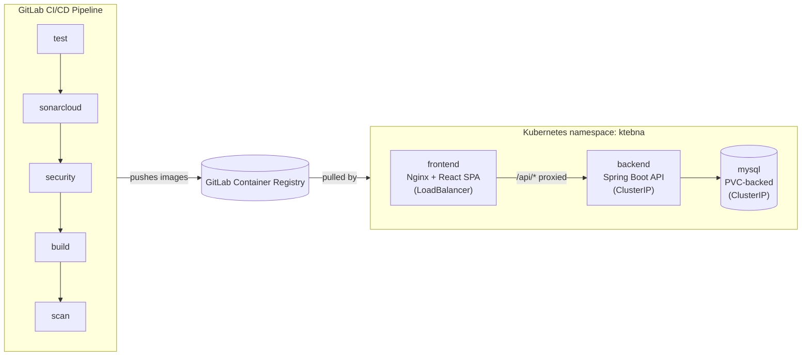
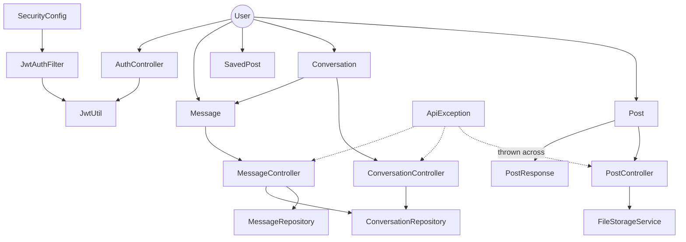

# Ktebna

**A DevSecOps CI/CD pipeline project.** 
The application itself — a peer-to-peer book marketplace — is the *subject* of the exercise, not the point of it. The actual work here is taking an already-functional app and wrapping it in a full security-gated CI/CD pipeline, deploying it to Kubernetes, and building the operational practices (incident response, credential management, rollback procedures) around it. Application feature work is intentionally minimal; almost everything in this repo — the pipeline, the security gates, the manifests, the incident history — exists to demonstrate DevSecOps practice, not to ship product features.

Built as part of the Arabsoft summer internship 2026.

**What Ktebna the app does**, for context: it's a platform for browsing, listing, buying, and exchanging books, with built-in messaging between users. That's it — the interesting engineering work in this repository is everything *around* that app, not the app itself.

For the full security posture, incident history, and credential-rotation record, see **[SECURITY.md](./SECURITY.md)**.

---

## Tech Stack

| Layer | Technology |
|---|---|
| Frontend | React 18, Vite, Tailwind CSS, framer-motion, MUI, react-i18next (EN/FR/AR), react-router-dom |
| Backend | Spring Boot 3.5, Java 17, Maven |
| Database | MySQL 8.0 |
| Auth | JWT (email/password), token stored client-side |
| File storage | Local disk, PVC-backed in Kubernetes |
| Local orchestration | Docker Compose |
| Container orchestration | Kubernetes (local cluster via Docker Desktop) |
| CI/CD | GitLab CI/CD, shared GitLab runners |
| Security scanning | SonarCloud (SAST), Gitleaks (secrets), Trivy (filesystem + image vulnerabilities) |

**History note:** the application was originally built on React + Supabase, then migrated to React + Spring Boot + MySQL specifically so this DevSecOps exercise would target self-controlled infrastructure rather than a managed backend-as-a-service.

---

## Architecture

### Deployment topology



The frontend is served as static assets by Nginx, which also reverse-proxies `/api/*` requests to the backend Service internally — this means the same build works identically in Docker Compose and in Kubernetes, since both environments have a service literally named `backend` on port `8080`, and the frontend never needs to know a specific hostname or port at build time.

### Codebase structure (backend domain model)

Generated from a static dependency analysis of the backend source (419 nodes, 952 edges across the full codebase; core domain relationships shown below). The most connected classes — `User`, `ApiException`, `UserDto`, `Conversation`, `Post` — are the project's central abstractions, which lines up with the four core features (auth, listings, messaging, favorites).



Full interactive dependency graph (419 nodes across the codebase) can be regenerated locally with `graphify update .` (requires [Graphify](https://github.com/) installed) — not committed to this repo, since it's a large, code-generated artifact that goes stale on every change.


---

## Features

Confirmed via direct inspection of the application's database schema and source code:

- **Authentication** — JWT-based registration and login
- **Book listings** — create, browse, and manage listings, with image upload
- **Messaging** — direct conversations between users tied to a specific listing, with email notifications on new messages
- **Saved posts** — users can save/favorite listings for later

---

## Getting Started (Local Development)

### Prerequisites
- Docker and Docker Compose

### Run locally
```bash
git clone https://gitlab.com/saifexd-group/ktebna.git
cd ktebna
docker-compose up -d
```

This starts three services:
- `mysql` — MySQL 8.0, exposed on host port `3307`
- `backend` — Spring Boot API, exposed on host port `8080`
- `frontend` — React app served via Nginx, exposed on host port `5173`

Open **http://localhost:5173** once all three containers report healthy.

### Environment variables
Configured via a `.env` file at the repo root (not committed — see `.gitignore`). Key variables:

| Variable | Purpose |
|---|---|
| `DB_ROOT_PASSWORD` | MySQL root password |
| `DB_PASSWORD` | MySQL app-user password |
| `JWT_SECRET` | Signing secret for JWTs (min. 32 characters) |
| `VITE_API_URL` | Frontend API base URL override (leave unset for relative `/api` — see Architecture above) |

---

## CI/CD Pipeline

Defined in `.gitlab-ci.yml`. Five stages, run on every push to `main`:

| Stage | Job(s) | Purpose |
|---|---|---|
| `test` | `backend-test`, `frontend-lint` | Unit tests (Maven), ESLint |
| `sonarcloud` | `sonarcloud-check` | Static Application Security Testing (SAST) |
| `security` | `gitleaks` | Secret-scanning across the full git history |
| `build` | `build-backend`, `build-frontend` | Docker image builds, pushed to GitLab Container Registry with both a commit-SHA tag and `:latest` |
| `scan` | `trivy-fs-backend`, `trivy-backend-image`, `trivy-frontend-image` | Filesystem and container image vulnerability scanning (Trivy) |

All 9 jobs must pass for a pipeline to go green. Results are visible under **CI/CD → Pipelines** in GitLab.

---

## Kubernetes Deployment

Manifests live in `k8s/`:
- `namespace.yaml` — the `ktebna` namespace
- `mysql.yaml` — MySQL Deployment, Service, and PVC
- `backend.yaml` — backend Secret, PVC (for uploads), Deployment, and Service
- `frontend.yaml` — frontend Deployment and Service (`type: LoadBalancer`)

### Deploy
```bash
kubectl apply -f k8s/
```

### Access locally
```bash
kubectl port-forward svc/frontend -n ktebna 8081:80
```
Then open **http://localhost:8081**. (The LoadBalancer's external IP is not directly reachable from the host in this local Docker Desktop setup — port-forwarding is the supported access method.)

### Image references
Both `backend.yaml` and `frontend.yaml` pin their container images to an exact digest (`@sha256:...`) rather than a floating `:latest` tag, so a `kubectl apply` can never silently redeploy unintended content. See **[Rollback Runbook](#rollback-runbook)** below for how to update these safely.

Private registry images require a `gitlab-registry` pull secret (a Kubernetes `docker-registry` Secret built from a GitLab Deploy Token) referenced via `imagePullSecrets` in both Deployments.

---

## Rollback Runbook

### To roll back to the last known-good image
The most reliable method found during this project (more reliable than `kubectl rollout undo`, which can land on a broken intermediate revision if the deployment history contains failed attempts):

1. Identify a pod that is confirmed healthy and running the desired version:
   ```bash
   kubectl get pods -n ktebna
   ```
2. Read its exact image reference directly:
   ```bash
   kubectl get pod <healthy-pod-name> -n ktebna -o jsonpath="{.status.containerStatuses[0].imageID}"
   ```
3. Set the Deployment to that exact reference:
   ```bash
   kubectl set image deployment/<name> <container-name>=<image-reference> -n ktebna
   ```
4. Watch the rollout and confirm the new pod reaches `1/1 Running` before the old one terminates:
   ```bash
   kubectl rollout status deployment/<name> -n ktebna
   ```

### If a Deployment gets stuck with duplicate/failed ReplicaSets
Delete the Deployment entirely (not just the pods) and reapply from the manifest:
```bash
kubectl delete deployment <name> -n ktebna
kubectl apply -f k8s/<name>.yaml
```

### If pods enter `ImagePullBackOff`
Check the exact error with `kubectl describe pod <pod-name> -n ktebna` and read the `Events` section. Common causes on this project, in order of frequency encountered:
1. **`401 Unauthorized`** — the `gitlab-registry` Secret's credentials no longer match a valid deploy token. Verify directly (bypassing Docker) with:
   ```bash
   curl -u "<username>:<password>" "https://gitlab.com/jwt/auth?service=container_registry&scope=repository:saifexd-group/ktebna/<backend|frontend>:pull"
   ```
   A `200` with a `token` field proves the credential is valid; if the Secret still fails afterward, recreate it.
2. **`manifest unknown` / `not found`** — the tag doesn't exist. GitLab CI tags images with the 8-character short commit SHA (`$CI_COMMIT_SHORT_SHA`) — verify the exact tag in the GitLab Container Registry UI rather than assuming its length.
3. **`short read: unexpected EOF`** — a known, unresolved issue on this project's local Docker Desktop Kubernetes node; see SECURITY.md / project history for the full diagnostic trail. Not caused by credentials or a bad tag — both were independently ruled out.

---

## Known Issues

- **Kubernetes image pull failure (unresolved, investigated and parked):** the local Docker Desktop Kubernetes node cannot pull newly built images past a fixed point (consistent `short read: unexpected EOF` at an identical byte offset). Tested and ruled out across two sessions: credentials (verified valid via direct registry auth checks), tag vs. digest reference, a full Docker Desktop restart, proxy interference (added the registry to Docker Desktop's proxy bypass list, restarted, retried — identical failure), and a full Kubernetes cluster reset (wiped and rebuilt the node from scratch, retried — identical failure). A control pull of a public Docker Hub image succeeded cleanly on the same node, confirming the issue is scoped specifically to this private registry's pull path, not general networking. Root cause not identified; formally accepted as a documented known issue rather than pursued further, given the scope of remaining, more actionable work. Deployments are pinned to the last successfully-pulled image as a stable, verified workaround. All application-level fixes referenced in this README have been fully verified via Docker Compose.
- ~~**Accessibility:** a browser console warning (`aria-hidden` blocked on an element with focus)...~~ — **Re-tested 10 Aug 2026, no longer reproduces.** Deliberately re-triggered via keyboard focus inside `MobileFiltersDrawer`/`MobileMenuDrawer` followed by close, with DevTools Console open — no warning appears, and `document.querySelectorAll('[aria-hidden="true"]')` shows only expected decorative icon SVGs (`lucide-react` icons, correctly marked to be skipped by screen readers), not `#root`. Likely resolved incidentally by a dependency update since the warning was first logged; not re-added as an open item.
- **Monitoring:** Prometheus + Grafana implemented and verified working in Docker Compose (metrics scraping, dashboard auto-provisioning, and live panel data all confirmed). Not deployed to Kubernetes, since the k8s track is parked (see above).

---

## A Note on What This Project Actually Demonstrates

The app-level bugs documented in this repo's history and in `SECURITY.md` — a race condition, a hardcoded config value, a misconfigured linter causing a false fix — are ordinary software bugs, not remarkable on their own. What this project is actually meant to show is the **process wrapped around them**: every one of those bugs was caught by a real gate or a real test rather than shipped silently, every credential incident was diagnosed with a repeatable, tool-independent verification method rather than guesswork, and every fix was verified in a lower environment before being pushed toward production. That process — not the app — is the deliverable.

---

## License

Internal internship project — not licensed for external distribution.
